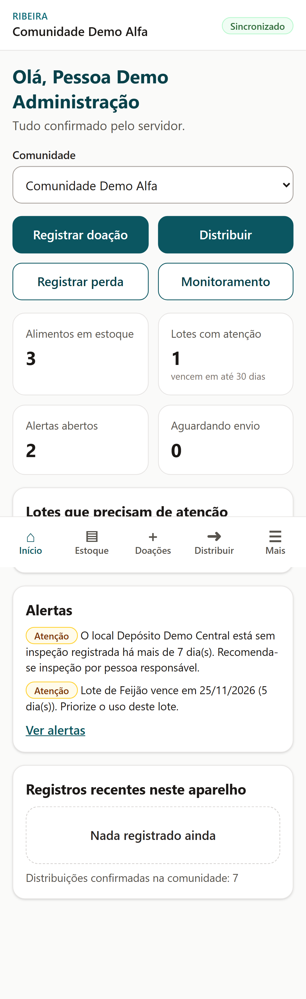
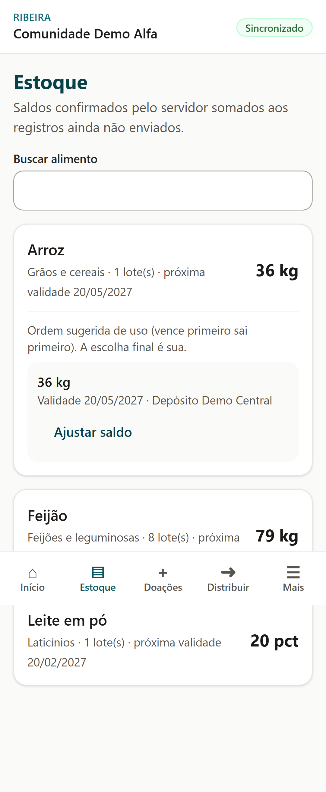
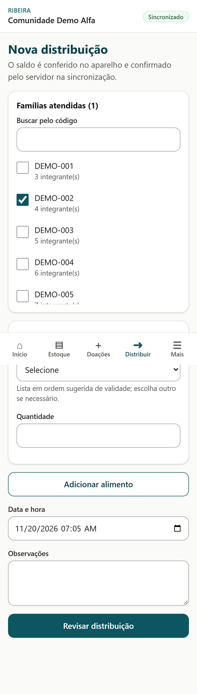
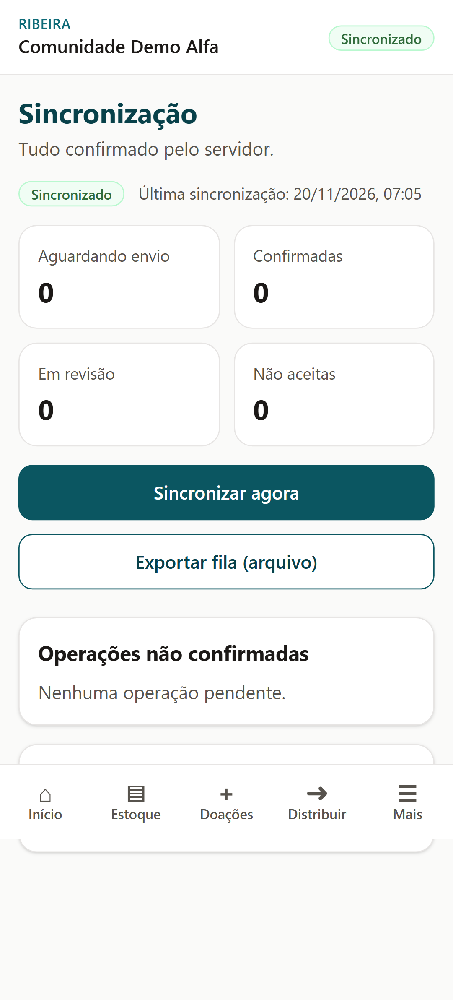

# Ribeira

Gestão de doações de alimentos para organizações que atendem comunidades
ribeirinhas do Amazonas — com funcionamento **offline-first** em celulares
Android de entrada.

[](https://github.com/mayro5a/ribeira/actions/workflows/ci.yml)

## O problema

Organizações sociais recebem doações e as distribuem para várias comunidades
ao longo dos rios. Nos depósitos e nos pontos de entrega quase nunca há
internet. Sem um registro confiável, fica difícil saber o que foi recebido,
onde está cada lote, o que chegou a cada família e quanto se perdeu por
umidade, calor ou validade.

## O que o Ribeira faz

- Registra **doações** e gera **lotes rastreáveis** com origem, local e validade.
- Mantém o **estoque** por um livro-razão imutável de movimentações (entrada,
  distribuição, perda, ajuste justificado); o saldo nunca fica negativo.
- Registra **distribuições** às famílias (identificadas só por código
  comunitário) com comprovante, e **perdas** com motivo.
- **Monitora** temperatura, umidade e inspeções, com **alertas por regras
  explícitas e configuráveis** (validade próxima, estoque mínimo, aumento de
  perdas, leitura fora da faixa, inspeção atrasada). O sistema nunca declara um
  alimento impróprio: recomenda inspeção por uma pessoa responsável.
- Funciona **sem internet** depois do primeiro acesso: os registros ficam no
  aparelho (IndexedDB) e são **sincronizados** quando a conexão volta, sem
  duplicar nada e preservando conflitos para revisão humana.
- Dashboards da comunidade (offline) e da organização (online), só com agregados.

## Público-alvo

Administradores de organizações, coordenadores comunitários, responsáveis por
estoque, distribuidores e pessoas que acompanham relatórios.

## Imagens

| Início | Estoque | Distribuição | Sincronização |
|:--:|:--:|:--:|:--:|
|  |  |  |  |

Dados fictícios de demonstração.

## Tecnologias

| Camada | Stack |
|--------|-------|
| Backend | Java 21, Spring Boot 3.5 (Web, Data JPA, Security, OAuth2 Resource Server, Validation, Actuator), PostgreSQL 17, Flyway, springdoc-openapi |
| Frontend | Next.js 16 (export estático), React 19, TypeScript estrito, Tailwind CSS 4, Dexie (IndexedDB), Zod, Service Worker próprio |
| Testes | JUnit 5, Testcontainers, ArchUnit, Vitest, Testing Library, fake-indexeddb, Playwright |
| Infra | Docker, Docker Compose, nginx, GitHub Actions, OSV-Scanner |

## Arquitetura

Monólito modular ([ADR-0001](docs/decisions/ADR-0001-monolito-modular.md))
com módulos `auth`, `organization`, `community`, `family`, `donor`, `food`,
`donation`, `inventory`, `distribution`, `loss`, `monitoring`, `alert`,
`report`, `sync` e `shared`. A PWA grava cada operação numa fila local e o
servidor a aplica de forma idempotente; o feed de alterações usa um cursor
emitido pelo servidor, sem lacunas entre páginas.

- [Arquitetura](docs/architecture.md) · [Requisitos](docs/requirements.md) ·
  [Banco de dados](docs/database.md) · [Sincronização](docs/synchronization.md) ·
  [API](docs/api.md) · [Segurança e privacidade](docs/security.md) ·
  [Testes](docs/testing.md) · [Decisões (ADRs)](docs/decisions/) ·
  [Diagramas](docs/diagrams/)

## Como executar

Pré-requisitos: Docker com Docker Compose.

```bash
cp .env.example .env
# Edite .env: POSTGRES_PASSWORD, RIBEIRA_JWT_SECRET (openssl rand -base64 48)
# e, para dados fictícios, RIBEIRA_DEMO_DATA_ENABLED=true e RIBEIRA_DEMO_PASSWORD.
docker compose up -d --build --wait
```

- Aplicação: <http://localhost:3000>
- Com dados de demonstração, entre com `admin@demo.ribeira.local` (ou
  `estoque@`, `distribuicao@`, `coordenacao@`, `consulta@` no mesmo domínio)
  e a senha definida em `RIBEIRA_DEMO_PASSWORD`.
- Sem dados de demonstração, defina `RIBEIRA_BOOTSTRAP_*` no `.env` para criar
  a primeira organização e o administrador.

Para testar o modo offline: entre, crie o PIN, aguarde "Sincronizado", ative o
modo avião (ou "Offline" nas ferramentas do navegador) e registre doações,
distribuições e perdas. Ao reconectar, use "Sincronizar agora".

### Desenvolvimento

```bash
# Backend (porta 8080) — requer JDK 21 e um PostgreSQL (docker compose up -d postgres)
cd ribeira-backend
RIBEIRA_DB_PASSWORD=... RIBEIRA_JWT_SECRET=... RIBEIRA_COOKIE_SECURE=false ./mvnw spring-boot:run

# Frontend (porta 3000) — requer Node 22+
cd ribeira-frontend
npm install
NEXT_PUBLIC_API_BASE_URL=http://localhost:8080 npm run dev
```

Swagger UI: <http://localhost:8080/swagger-ui.html> (fora do perfil `prod`).

## Como testar

```bash
cd ribeira-backend && ./mvnw verify          # 72 testes (unitários + PostgreSQL real)
cd ribeira-frontend && npm run check          # formatação, lint, tipos, 51 testes
cd ribeira-frontend && npx playwright test    # E2E offline (stack no ar)
```

Detalhes e mapeamento dos cenários de aceitação em [docs/testing.md](docs/testing.md).

## Limitações conhecidas

- **Não validado em campo.** Unidades de medida, códigos de família, parâmetros
  de alerta e o tempo de sessão offline são hipóteses a validar com as
  comunidades ([requirements.md §6](docs/requirements.md)).
- IndexedDB não é criptografado; um aparelho perdido só é revogado quando se
  conecta. Ver o [modelo de ameaças](docs/security.md#5-modelo-de-ameaças-simplificado).
- Cadastros (famílias, alimentos, usuários) e resolução de alertas/conflitos
  exigem conexão.
- Um aparelho principal por comunidade é a estratégia conservadora para
  estoque offline concorrente; não há cotas por aparelho.
- Limite de tentativas de login em memória (uma instância).
- Recuperação de senha por e-mail não implementada (o administrador redefine).
- Não está pronto para produção: falta teste de restauração de backup,
  revisão jurídica (LGPD) e validação de acessibilidade com usuários.

## Roadmap

1. Validação com representantes comunitários e ajuste dos parâmetros.
2. Divisão de um item de doação em vários lotes na interface; transferências entre locais.
3. Cotas de estoque por aparelho para operação offline simultânea.
4. Compactação do feed de sincronização e cursor por escopo de permissão.
5. Criptografia local com gestão de chaves; recuperação de senha por e-mail.
6. Leituras por sensores (após base histórica confiável); depois, modelos preditivos.

## Dados e privacidade

Nenhum dado real de pessoas está no repositório. Famílias são identificadas só
por código comunitário; relatórios não expõem dados pessoais.
