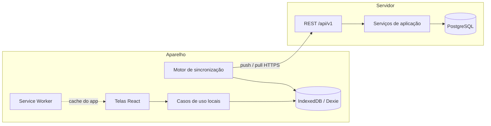

# Arquitetura — Ribeira

## 1. Visão geral

Ribeira é um **monólito modular** (ver [ADR-0001](decisions/ADR-0001-monolito-modular.md))
composto por:

- **ribeira-backend** — API REST Java 21 / Spring Boot 3.5, fonte de verdade
  de saldos, autorização e auditoria. PostgreSQL com migrações Flyway.
- **ribeira-frontend** — PWA Next.js exportada como site estático, com
  IndexedDB (Dexie) como armazenamento local e uma fila de operações
  sincronizada com o servidor.



Diagrama completo: [diagrams/architecture.mmd](diagrams/architecture.mmd).

## 2. Backend

### 2.1 Módulos

```text
com.ribeira
├── auth          usuários, papéis, permissões, login, tokens
├── organization  organizações
├── community     comunidades e vínculo de usuários
├── family        famílias beneficiadas
├── donor         doadores
├── food          catálogo de alimentos
├── donation      doações e itens
├── inventory     locais, lotes, movimentações, saldos, FEFO
├── distribution  distribuições
├── loss          perdas
├── monitoring    condições de armazenamento e leituras
├── alert         regras explícitas de alerta
├── report        dashboards e relatórios
├── sync          dispositivos, push/pull, idempotência, conflitos
└── shared        config, exception, security, audit, contratos comuns
```

Cada módulo usa, quando faz sentido, os pacotes:

- `api` — controllers e DTOs (records). Não acessa JPA.
- `application` — casos de uso, fronteiras transacionais e autorização.
- `domain` — entidades, invariantes e repositórios Spring Data.

A pasta `infrastructure` só é criada quando há integração técnica real
(ver [ADR-0007](decisions/ADR-0007-estrutura-de-modulos.md)).

### 2.2 Regras de dependência

- Um módulo **não** usa repositórios de outro módulo; integra-se pelos
  serviços de aplicação públicos (ex.: `distribution` chama
  `InventoryService.withdraw`). Verificado por testes ArchUnit.
- Referências entre módulos são por UUID, não por associação JPA.
- `shared` não depende de nenhum módulo de negócio.
- O registro de alterações para sincronização é feito via a interface
  `shared.sync.ChangeTracker`, implementada pelo módulo `sync`, evitando
  que módulos de negócio dependam dele.

### 2.3 Transações e concorrência

- `@Transactional` apenas na camada `application`.
- Baixa de estoque com `SELECT ... FOR UPDATE` (bloqueio pessimista) nos
  lotes, sempre em ordem de ID para evitar deadlock
  ([ADR-0004](decisions/ADR-0004-concorrencia-de-estoque.md)).
- `CHECK (available_quantity >= 0)` como última linha de defesa.

### 2.4 Erros

Todas as respostas de erro seguem **Problem Details (RFC 9457)** com os
campos adicionais `code` (estável, para o cliente), `correlationId` e
`errors` (validação de campos). Ver [api.md](api.md).

## 3. Frontend

```text
src/
├── app/            rotas (App Router, export estático)
├── components/     biblioteca de componentes acessíveis (ui/) e layout
├── features/       funcionalidades: casos de uso e telas por domínio
├── lib/
│   ├── api/        cliente HTTP, contratos validados com zod
│   ├── db/         esquema Dexie e repositórios locais
│   ├── sync/       fila, máquina de estados, motor de push/pull
│   └── domain/     tipos e regras puras (quantidades, projeção de saldo)
└── sw/             gerador do Service Worker
```

- Componentes visuais não contêm regras de sincronização nem de estoque.
- Toda escrita essencial grava **na mesma transação IndexedDB** a operação
  da fila e, quando necessário, o registro local provisório.
- Saldos exibidos = snapshot confirmado pelo servidor − efeitos das
  operações ainda não refletidas (projeção local, sempre identificada como
  provisória). Ver [synchronization.md](synchronization.md).
- Export estático + Service Worker próprio com precache versionado
  ([ADR-0006](decisions/ADR-0006-pwa-export-estatico.md)).

## 4. Implantação

`docker-compose.yml` sobe PostgreSQL, backend e frontend (nginx servindo o
export estático e encaminhando `/api` ao backend, o que mantém mesma origem
e cookies `SameSite=Strict`).

## 5. Decisões registradas

| ADR | Assunto |
|-----|---------|
| [0001](decisions/ADR-0001-monolito-modular.md) | Monólito modular |
| [0002](decisions/ADR-0002-uuid-gerado-no-cliente.md) | UUIDs gerados no aparelho |
| [0003](decisions/ADR-0003-feed-de-alteracoes.md) | Feed de alterações e cursor de sincronização |
| [0004](decisions/ADR-0004-concorrencia-de-estoque.md) | Concorrência de estoque |
| [0005](decisions/ADR-0005-autenticacao.md) | Autenticação e sessão offline |
| [0006](decisions/ADR-0006-pwa-export-estatico.md) | PWA com export estático e Service Worker próprio |
| [0007](decisions/ADR-0007-estrutura-de-modulos.md) | Estrutura interna dos módulos |
| [0008](decisions/ADR-0008-componentes-de-interface.md) | Biblioteca de componentes |
