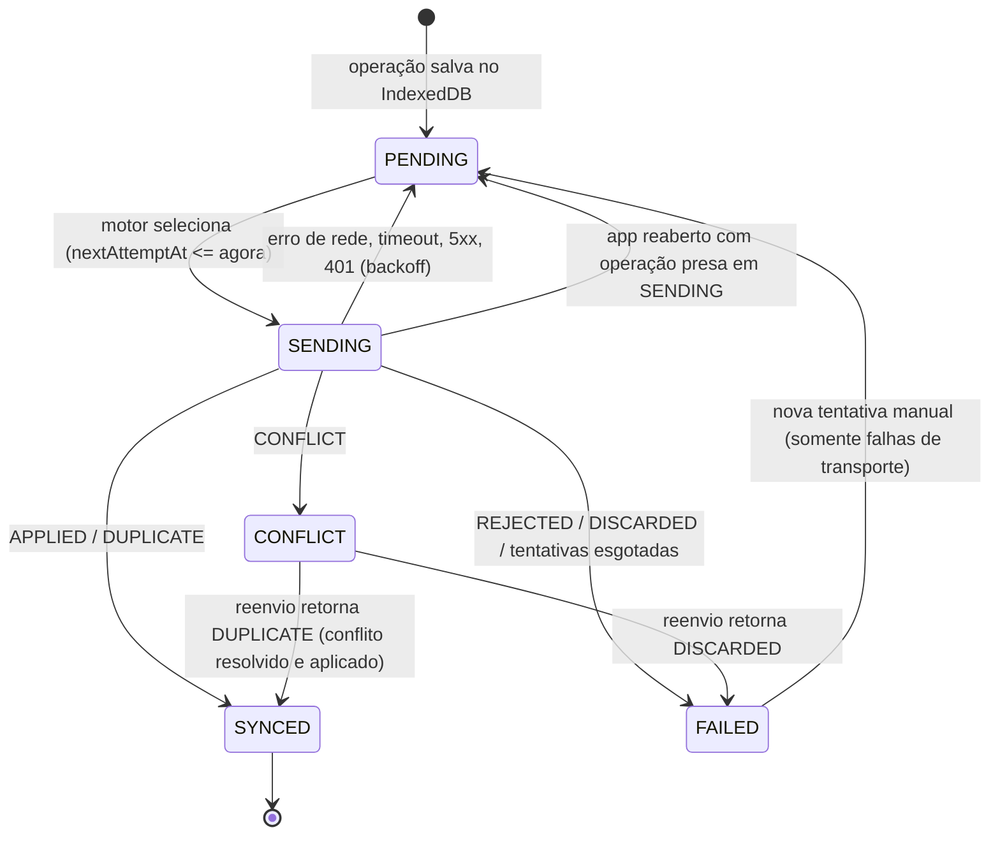

# Sincronização — contrato e máquina de estados

Este é o contrato entre a PWA e o servidor. Alterações incompatíveis exigem
novo `schemaVersion` por tipo de operação, e o servidor deve aceitar a
versão anterior enquanto houver aparelhos com operações pendentes nela.

## 1. Princípios

1. **Movimentações, não saldos.** O aparelho envia fatos (doação recebida,
   distribuição feita, perda registrada). O servidor recalcula saldos; o
   saldo local nunca sobrescreve o central.
2. **IDs gerados no aparelho** (UUID v4) para toda entidade criada offline
   ([ADR-0002](decisions/ADR-0002-uuid-gerado-no-cliente.md)). Operações
   posteriores referenciam esses IDs, preservando a ordem causal.
3. **Idempotência no servidor.** `operationId` é chave primária de
   `sync_operations`; processamento e registro ocorrem na mesma transação.
4. **Nada é descartado silenciosamente.** Operações rejeitadas ou em
   conflito ficam registradas para revisão humana auditável.
5. **Cursor emitido pelo servidor.** O relógio do aparelho serve apenas
   para auditoria (`createdAt`), nunca para ordenar alterações.
6. **Sem merge por última escrita** para saldos, distribuições ou perdas.

## 2. Envelope da operação

```json
{
  "operationId": "7f1c0e9a-3c55-4f0e-9a39-0c5d8b8c2a10",
  "deviceId": "0b8a7c43-6a0e-4d2c-9a7d-3f4b5c6d7e8f",
  "communityId": "b1c2d3e4-0000-4000-8000-000000000001",
  "entityType": "DISTRIBUTION",
  "operationType": "DISTRIBUTION_CREATE",
  "createdAt": "2026-11-20T13:45:00Z",
  "schemaVersion": 1,
  "payload": { }
}
```

Quantidades trafegam como **strings decimais** (`"3.500"`) para evitar
ponto flutuante.

### 2.1 Tipos de operação (schemaVersion 1)

| operationType | entityType | Payload |
|---------------|-----------|---------|
| `DONATION_RECEIVE` | `DONATION` | `donationId`, `donorId?`, `originDescription?`, `receivedAt`, `notes?`, `items[]` (`itemId`, `foodId`, `quantity`, `unit`, `notes?`, `batches[]` (`batchId`, `quantity`, `storageLocationId?`, `expirationStatus`, `expirationDate?`, `notes?`)) |
| `BATCH_ENTRY` | `BATCH` | `batchId`, `foodId`, `quantity`, `unit`, `originDescription`, `receivedAt`, `storageLocationId?`, `expirationStatus`, `expirationDate?`, `notes?` |
| `STOCK_ADJUSTMENT` | `MOVEMENT` | `movementId`, `batchId`, `quantityDelta`, `justification` |
| `DISTRIBUTION_CREATE` | `DISTRIBUTION` | `distributionId`, `distributedAt`, `notes?`, `familyIds[]`, `items[]` (`itemId`, `batchId`, `quantity`) |
| `LOSS_RECORD` | `LOSS` | `lossId`, `batchId`, `quantity`, `occurredAt`, `reason`, `description?` |
| `READING_RECORD` | `READING` | `readingId`, `storageLocationId`, `temperature?`, `humidity?`, `inspection`, `notes?`, `recordedAt` |

Cadastros administrativos (comunidades, usuários, alimentos, famílias,
doadores) são feitos online via REST no MVP.

## 3. Push

`POST /api/v1/sync/push` — até 25 operações por requisição, na ordem em que
foram criadas no aparelho.

```json
{ "deviceId": "…", "operations": [ { "operationId": "…" } ] }
```

Resposta `200` com um resultado por operação:

```json
{
  "results": [
    { "operationId": "…", "outcome": "APPLIED", "serverSeq": 1042 },
    { "operationId": "…", "outcome": "DUPLICATE", "serverSeq": 1001 },
    { "operationId": "…", "outcome": "CONFLICT", "errorCode": "INSUFFICIENT_STOCK",
      "message": "Saldo insuficiente no lote …", "conflictId": "…" },
    { "operationId": "…", "outcome": "REJECTED", "errorCode": "VALIDATION_FAILED",
      "message": "…" }
  ]
}
```

| outcome | Significado | Registrado no servidor |
|---------|-------------|------------------------|
| `APPLIED` | Processada agora | Sim, com resultado e `serverSeq` |
| `DUPLICATE` | Já processada antes com o mesmo payload; nada é reexecutado | Já existia |
| `CONFLICT` | Válida, mas incompatível com o estado central (saldo, referência ausente, aparelho não principal) | Sim + `sync_conflicts` |
| `REJECTED` | Inválida (formato, permissão, regra violada que não depende do estado) | Sim + `sync_conflicts` |
| `DISCARDED` | Conflito revisado e descartado por pessoa autorizada | Sim |

Regras:

- O processamento de cada operação ocorre em **transação própria**: uma
  falha não desfaz nem bloqueia as demais.
- Se o `operationId` já existir com **payload diferente** (hash SHA-256 do
  JSON canônico de `communityId`, `operationType`, `schemaVersion` e
  `payload`), o resultado é `REJECTED` com `OPERATION_ID_REUSED` e nada é
  gravado.
- Reenviar uma operação já registrada devolve o **estado atual** dela.
  É assim que o aparelho descobre que um conflito foi resolvido.
- `serverSeq` é a posição no feed de alterações que contém os efeitos da
  operação. O aparelho continua aplicando a projeção local da operação até
  que seu cursor alcance esse valor.
- Erros de toda a requisição: `401` (sessão expirada), `403` com
  `DEVICE_REVOKED` ou `DEVICE_NOT_REGISTERED`, `400` (envelope inválido),
  `5xx`. Nesses casos nenhuma operação muda de estado no aparelho além do
  retorno a `PENDING`.

### 3.1 Aparelho principal

Se a comunidade tiver `primaryDeviceId` definido, operações que alteram
estoque vindas de outro aparelho resultam em `CONFLICT`
(`DEVICE_NOT_PRIMARY`) e ficam para revisão. Sem aparelho principal, o
servidor revalida saldo de cada operação e registra conflito quando operações
concorrentes excedem o saldo.

## 4. Pull

`GET /api/v1/sync/pull?cursor={cursor}&limit={1..500}` com cabeçalho
`X-Device-Id`.

```json
{
  "changes": [
    { "seq": 1043, "entityType": "BATCH", "entityId": "…",
      "communityId": "…", "data": { } }
  ],
  "nextCursor": "1043",
  "hasMore": false,
  "serverTime": "2026-11-20T14:00:00Z"
}
```

- `cursor` é **opaco** para o cliente; ausente significa carga inicial.
- `data` é o estado atual completo da entidade (não um diff). Exclusões são
  lógicas (`active: false` ou `status`), então sempre há um snapshot.
- Cada página contém até `limit` entradas do feed; o cliente repete enquanto
  `hasMore` for verdadeiro e só grava o novo cursor **depois** de aplicar a
  página localmente, na mesma transação IndexedDB.
- Somente entradas de comunidades que o usuário pode ler são entregues;
  famílias exigem `FAMILY_READ`.

### 4.1 Por que não há lacunas entre páginas

O `seq` vem de um contador por organização (`sync_counters`) incrementado
com bloqueio de linha no **último passo antes do commit**. Duas transações
da mesma organização não intercalam números, então a ordem do `seq` é a
ordem de commit e uma leitura com `seq > cursor` nunca pula uma transação
em andamento ([ADR-0003](decisions/ADR-0003-feed-de-alteracoes.md)).

## 5. Máquina de estados no aparelho



| Estado | Significado | Efeito na projeção local |
|--------|-------------|--------------------------|
| `PENDING` | Aguardando envio | Aplicado (provisório) |
| `SENDING` | Em envio | Aplicado (provisório) |
| `SYNCED` | Confirmado pelo servidor | Aplicado até `cursor >= serverSeq` |
| `CONFLICT` | Aguardando revisão no servidor | Não aplicado; destacado na interface |
| `FAILED` | Rejeitado, descartado ou sem transporte após N tentativas | Não aplicado; destacado na interface |

- **Backoff:** `min(5 min, 2 s × 2^tentativas)` com *full jitter*; após 8
  tentativas a operação vai para `FAILED` com `failureKind = TRANSPORT` e
  pode ser reenviada manualmente.
- **Recuperação de crash:** ao iniciar, operações em `SENDING` voltam para
  `PENDING`. Isso é seguro porque o servidor é idempotente — inclusive no
  caso de commit no servidor seguido de perda da resposta.
- A interface **nunca** mostra `SYNCED` antes da resposta do servidor.
- O motor roda ao abrir o app, ao voltar a conexão, a cada 60 s com o app
  aberto e por ação manual. Não há promessa de execução em segundo plano.
- Conectividade é inferida pelo sucesso real das requisições; o evento
  `online` do navegador apenas antecipa uma tentativa.

## 6. Resolução de conflitos

`GET /api/v1/sync/conflicts?status=OPEN` lista conflitos e rejeições das
comunidades em que o usuário tem `SYNC_CONFLICT_RESOLVE`.

`POST /api/v1/sync/conflicts/{id}/resolution`

```json
{ "decision": "RETRY", "notes": "Saldo corrigido após recontagem" }
```

- `RETRY` — reexecuta a operação original contra o estado atual (ex.: depois
  de um ajuste justificado). Se aplicar, a operação passa a `APPLIED`.
  Se falhar de novo, a tentativa entra no histórico e o conflito continua
  aberto.
- `DISCARD` — a operação passa a `DISCARDED`; exige `notes`.

O registro original, o motivo, o histórico de tentativas
(`sync_conflict_events`) e a decisão com autor e data são preservados.

## 7. Aparelhos, revogação e sessão offline

- O aparelho é registrado em `POST /api/v1/devices` após o login.
- Um aparelho revogado recebe `403 DEVICE_REVOKED` em push e pull assim que
  o servidor processa a revogação. **Não é possível revogar
  instantaneamente um aparelho que continua desconectado**: até se
  reconectar, ele mantém os dados já baixados. Mitigação: sessão offline
  com validade limitada (padrão 7 dias, renovada a cada contato com o
  servidor) e bloqueio por PIN local.
- Ao receber `DEVICE_REVOKED`, o aparelho apaga os snapshots locais
  (incluindo famílias) e mantém apenas a fila de operações para exportação
  controlada.

## 8. Notas de implementação

- Operação para comunidade inexistente ou de outra organização recebe
  `REJECTED` / `COMMUNITY_NOT_FOUND` e **não** é gravada no servidor (não pode
  referenciar outro tenant); ela permanece no aparelho como `FAILED`.
- `RETRY` reexecuta a operação sob a autoridade de quem revisa: as permissões
  e o responsável registrados são os do revisor; o autor original continua em
  `sync_operations.user_id` e na auditoria.
- Aparelho compartilhado: só as operações do usuário autenticado são enviadas.
  Ao trocar de usuário, os snapshots locais são apagados e o cursor volta a zero.
- Erros inesperados (5xx) durante o push falham a requisição inteira; o aparelho
  reenvia com backoff e as já aplicadas retornam `DUPLICATE`.
- O formulário de doação cria um lote por item; o contrato já aceita vários
  lotes por item para uma versão futura da interface.

## 9. Limites conhecidos do MVP

- Se as permissões de um usuário aumentarem, alterações anteriores ao cursor
  não são reenviadas; um novo login com outro usuário ou a limpeza dos dados
  locais força a carga completa. Evolução prevista: cursor por escopo de permissão.

- O feed de alterações não é compactado; a carga inicial percorre todo o
  histórico da organização. Adequado ao volume esperado; compactação e
  `410 Gone` para cursores antigos estão no roadmap.
- `sync_operations` é retido indefinidamente (é também trilha de auditoria).
- Não há transferência de cotas de estoque entre aparelhos. Evolução
  prevista: cota por aparelho ou por local de armazenamento.
